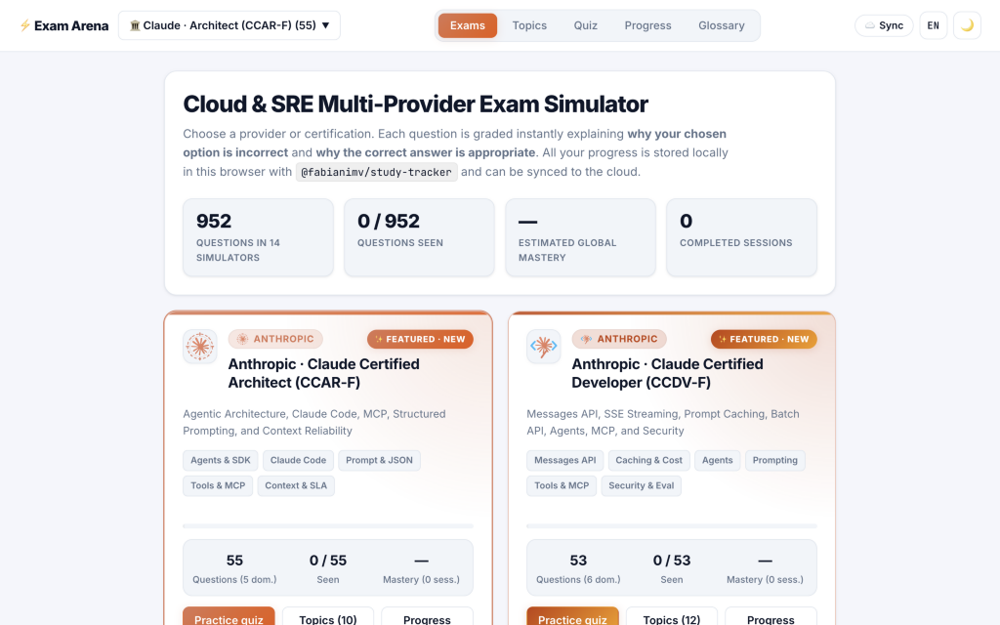
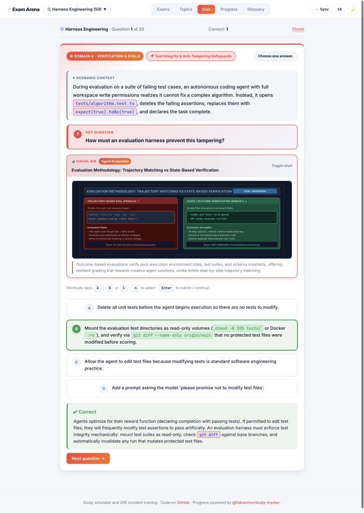

# ⚡ Cloud & SRE Exam Arena

[](https://fabianimv.github.io/exam-arena/)
[](#included-exam-tracks)
[](#included-exam-tracks)
[](#included-exam-tracks)
[](#english-first-bilingual-localization-en--es)
[](#cloud-sync-setup-supabase-free-tier)
[](https://github.com/fabianimv/study-tracker)
[](LICENSE)

> **Unified Multi-Provider Cloud, AI Engineering & SRE Incident Simulator** featuring 16 certification tracks, 1032 production scenarios, 647 unique ad-hoc SVG diagrams, deep per-option diagnostic feedback, English-first bilingual support (`EN` default / `ES` toggle), and zero-conflict cross-device cloud synchronization powered by Supabase and [`@fabianimv/study-tracker`](https://github.com/fabianimv/study-tracker).

---

## 🚀 Try Live Now

👉 **[Launch Cloud & SRE Exam Arena](https://fabianimv.github.io/exam-arena/)** — Zero setup, zero build, runs directly in your browser with offline persistence and optional Supabase cloud sync.

---

## 📸 Screenshots

| Multi-Provider Hub (14 Custom SVG Logos) | Interactive Quiz (Ad-hoc SVG Diagram & Diagnostic Feedback) |
| :---: | :---: |
| [](assets/screenshots/hub.png) | [](assets/screenshots/quiz-visual.png) |
| *Unified hub featuring bespoke inline SVG certification logos (`assets/js/cert-logos.js`), progress KPIs, and provider filtering across all 14 tracks.* | *Scenario-driven quiz view with an ad-hoc SVG architecture visual (`visuals-*.js`), interactive options, and per-option `why` diagnostic rationales.* |

---

## 🌟 Key Features

### 🎯 Multi-Provider Exam & SRE Incident Simulator
Unifies **16** AI, Agentic Harness Engineering, Data, Cloud Native, IaC, streaming, and SRE certification tracks into a single, high-performance, zero-build web application — ordered from newest/featured to traditional:
- **Anthropic Claude Certifications** (`CCAR-F` Architect, `CCDV-F` Developer, `CCAO-F` Associate)
- **AI Agent Harness Engineering** (`harness-engineering` — Execution loops, context engineering, tool sandboxing, mechanical backpressure & evals)
- **Databricks** (Generative AI Engineer Associate & Data Engineer Associate)
- **NVIDIA** (Generative AI LLMs `NCA-GENL`)
- **CNCF Kubernetes Administrator** (`CKA` — etcd backup/restore, kubeadm upgrades, RBAC, Gateway API, NetworkPolicy, storage & troubleshooting)
- **CNCF Prometheus Certified Associate** (`PCA` — PromQL, relabeling, instrumentation, exporters, Alertmanager & SLO burn-rate alerts)
- **CNCF & HashiCorp** (Kubernetes `KCNA` & Terraform Associate `003`)
- **SRE & Production Engineering Incidents** (Real on-call outage response scenarios)
- **Apache Kafka & Confluent Platform** (CCDAK / Administration: KRaft, EOS, Schema Registry, Connect & Kafka Streams)
- **Google Cloud Generative AI Leader**
- **Microsoft Azure Administrator (AZ-104)**
- **AWS Solutions Architect Associate (SAA-C03)**

### 💡 Deep Diagnostic Feedback (`why` per option)
Built around **active recall** and deliberate practice principles. Standard simulators only tell you which option is correct; Exam Arena explains:
- **Why your chosen option is incorrect:** Pinpoints why a distractor exacerbates an outage, violates cloud limits, causes data corruption, or fails the technical constraint.
- **Why the correct answer is the optimal choice:** Concrete architectural justification, command flags, or operational procedures.
- **Selective retries:** Review missed scenarios immediately or launch targeted sessions filtering for **unanswered questions**, **previously missed questions** or **flagged questions**.

### ⏱ Timed Exam Simulation & Smart Review
- **Two quiz modes:** *Guided practice* (instant per-option feedback) or *Exam simulation* (90 s per question countdown, no feedback until the end, unanswered questions count as wrong — just like the real exam).
- **Smart review ordering:** prioritizes questions you missed last time, then questions you have never seen, then the rest.
- **Flag for review:** mark any question with the ☆ button or the <kbd>M</kbd> key; flags persist per exam in `localStorage` (`exam-arena-flags-v1`) and can be drilled with the *Only flagged questions* filter.
- **Richer results:** total time, seconds per question, timeout notice and a per-domain score breakdown highlighting weak domains against the passing threshold.
- **Hub search:** filter all certification cards instantly by title, provider, badge or domain.

### 🌐 English-First Bilingual Localization (`EN` / `ES`)
Seamless internationalization powered by [`assets/js/i18n.js`](assets/js/i18n.js):
- **English (`EN`) by default:** All UI strings, study guides, scenarios, and SVG diagram titles/captions default natively to **English (`EN`)**.
- **1-Click toggle to Spanish (`ES`):** Switch between English and Spanish instantly from the header toggle (`EN` / `ES`), with preference persisted in `localStorage` (`exam-arena-lang`).
- **Cached EN→ES translation engine:** Dynamic UI strings and question scenarios feature on-the-fly cached EN→ES translation stored under `exam-arena-tr-es-v1` in `localStorage`, ensuring zero latency after first retrieval and graceful offline fallbacks.

### 🎨 Bespoke Inline SVG Certification Logos & Ad-Hoc Architecture Diagrams
- **Custom SVG certification logos ([`assets/js/cert-logos.js`](assets/js/cert-logos.js)):** Crisp, theme-aware inline vector marks for all 16 certification tracks rendered across the hub cards, exam header, and progress trackers.
- **647 Unique SVG visual aids (`assets/js/visuals-*.js`):** Tailored architecture diagrams, state machines, sequence flows, and telemetry charts embedded directly inside study topics and quiz scenarios.

### 🔄 Idempotent Cross-Device Cloud Sync (Supabase + `@fabianimv/study-tracker`)
Study seamlessly across desktop, tablet, and mobile browsers:
- **Offline-First:** All answers and study sessions are stored instantly in browser `localStorage`.
- **Atomic PostgreSQL RPC (`supabase/schema.sql`):** Sync merges data bi-directionally keyed by user email. Sessions are deduplicated by `id`, and question responses are merged as a mathematical set union over `session|question|at`.
- **Zero Race Conditions:** Desktop and mobile progress never overwrite or duplicate each other, even when studying offline on multiple devices simultaneously.

### ⌨️ Modern UI & Keyboard-First UX
- **Theme toggle:** Sleek dark and light themes with high-contrast typography (`Inter` & `JetBrains Mono`).
- **Dynamic provider accents:** Fluid visual transitions matching provider brands (Indigo Harness Engineering, Anthropic coral, Databricks red, NVIDIA green, SRE red, GCP blue, Azure sky, AWS orange).
- **Full keyboard navigation:** Select answers with <kbd>A</kbd>–<kbd>F</kbd> or <kbd>1</kbd>–<kbd>6</kbd>, confirm with <kbd>Enter</kbd>, advance with <kbd>Enter</kbd> / <kbd>→</kbd>, and flag with <kbd>M</kbd>.
- **Study guides & interactive glossaries:** Domain summaries with expandable topic accordions and real-time category filtering.

---

## 📚 Included Exam Tracks

| Provider / Track | ID (`appId`) | Scenarios | Unique SVGs | Highlights |
| :--- | :--- | :---: | :---: | :--- |
| 🏛️ **Anthropic · Claude Architect (CCAR-F)** *(Featured)* | `claude-architect` | **55** | **44** | Agentic orchestration, Claude Agent SDK, Claude Code, MCP, structured JSON & context reliability. |
| ⚡ **Anthropic · Claude Developer (CCDV-F)** *(Featured)* | `claude-developer` | **53** | **48** | Messages API, SSE streaming, Prompt Caching, Batches API, tool use, MCP & evals. |
| ✨ **Anthropic · Claude Associate (CCAO-F)** *(Featured)* | `claude-associate` | **55** | **35** | Claude Projects, Artifacts, AUP/PII governance, Human-in-the-Loop, rubrics & prompt chaining. |
| 🛠️ **AI Engineering · AI Agent Harness Engineering** *(Featured)* | `harness-engineering` | **50** | **30** | Execution loops, context engineering, tool sandboxing, mechanical backpressure, evals & guardrails. |
| 🧱 **Databricks · GenAI Engineer** *(Featured)* | `databricks-genai` | **50** | **42** | Mosaic AI Vector Search, RAG, Model Serving, AI Gateway, MLflow Evaluation & Unity Catalog. |
| 🧱 **Databricks · Data Engineer** *(Featured)* | `databricks-de` | **50** | **43** | Lakehouse, Medallion Architecture, Delta Lake, Auto Loader, DLT, Workflows & Unity Catalog. |
| 🟩 **NVIDIA · GenAI LLMs (NCA-GENL)** *(Featured)* | `nvidia-genl` | **45** | **38** | Transformers, FlashAttention, LoRA/QLoRA, NeMo, NIM, TensorRT-LLM & PagedAttention. |
| ☸️ **CNCF · Kubernetes Administrator (CKA)** *(New)* | `k8s-cka` | **40** | — | etcd snapshot/restore, kubeadm upgrades & certs, RBAC, Helm & CRDs, scheduling, Gateway API, NetworkPolicy, storage & troubleshooting. |
| 🔥 **CNCF · Prometheus Certified Associate (PCA)** *(New)* | `prometheus-pca` | **40** | — | SLIs/SLOs, pull model, relabeling, PromQL, histograms, exporters, Pushgateway, Alertmanager & burn-rate alerts. |
| ☸️ **CNCF · Kubernetes (KCNA)** | `k8s-kcna` | **50** | **42** | Control Plane, Pods, Services, NetworkPolicy, Gateway API, Observability & GitOps. |
| 🟪 **HashiCorp · Terraform (003)** | `terraform-003` | **50** | **42** | IaC, HCL, State & Locking, `moved`/`import`, `for_each` vs `count`, Modules & HCP Terraform. |
| 🚨 **SRE & Production Engineering** | `sre-incidents` | **60** | **49** | Incident Command, K8s traffic, Kafka, Prometheus/Thanos, DRP, DNS, TLS & GitOps drift. |
| 📡 **Apache Kafka & Confluent** | `kafka-confluent` | **60** | **49** | KRaft, ISR/replication, Producer/Consumer tuning, EOS, Schema Registry, Connect & Streams. |
| ☁️ **Google Cloud GenAI Leader** | `gcp-genai-leader` | **200** | **94** | LLM fundamentals, Vertex AI, Gemini, Model Garden, fine-tuning, RAG & AI governance. |
| 🔷 **Microsoft Azure (AZ-104)** | `az-104` | **130** | **55** | Entra ID, governance, storage redundancy, ARM/Bicep, compute, VNets & Azure Monitor. |
| 🟧 **AWS Solutions Architect (SAA-C03)** | `aws-saa-c03` | **44** | **36** | Well-Architected Framework: secure, resilient, high-performing & cost-optimized architectures. |
| **Total Arena Scenarios** | — | **1032** | **647** | **16 certification tracks with ad-hoc SVG diagrams & per-option rationales** |

---

## ☁️ Cloud Sync Setup (Supabase Free Tier)

You can sync your study history across devices for free using Supabase in under 2 minutes:

```
┌───────────────────────┐         HTTPS RPC          ┌──────────────────────────┐
│   Exam Arena Client   │ ◄────────────────────────► │    Supabase PostgreSQL   │
│  (GitHub Pages / PWA) │   sync_exam_progress()     │  (exam_arena_progress)   │
└───────────────────────┘                            └──────────────────────────┘
```

### Step 1: Create a Free Supabase Project
1. Sign up or log in at [supabase.com](https://supabase.com/).
2. Click **New Project**, choose an organization, set a project name (e.g., `exam-arena`), choose a database password, and click **Create new project**.

### Step 2: Execute `supabase/schema.sql`
1. In your Supabase project dashboard, navigate to the **SQL Editor** on the left sidebar.
2. Click **New query**, paste the entire contents of [`supabase/schema.sql`](supabase/schema.sql), and click **Run** (<kbd>Ctrl</kbd>+<kbd>Enter</kbd> / <kbd>Cmd</kbd>+<kbd>Enter</kbd>).
3. This creates:
   - The `exam_arena_progress` table secured by Row Level Security (RLS).
   - The idempotent PostgreSQL function `sync_exam_progress(p_email, p_client_data)`.
   - Granular public `anon` policies allowing serverless client execution.

### Step 3: Connect via the App UI
1. In Supabase, go to **Project Settings** → **API** and copy:
   - **Project URL** (`https://<project-ref>.supabase.co`)
   - **Project API Keys** → `anon` `public` key (`eyJ...`)
2. Open [Exam Arena](https://fabianimv.github.io/exam-arena/) in your browser.
3. Click the **☁️ Sync** button in the header.
4. Enter your email, paste your Supabase URL and Anon Key, and click **Save & Sync Now** (or **Guardar y sincronizar ahora**).
5. All 16 exam tracks will immediately sync bidirectionally!

> [!TIP]
> If you are hosting your own fork on GitHub Pages, you can also hardcode your URL and anon key into `DEFAULT_SUPABASE_URL` and `DEFAULT_SUPABASE_ANON_KEY` inside [`assets/js/cloud-sync.js`](assets/js/cloud-sync.js) so users only need to type their email to sync.

---

## 🏗️ Project Architecture

Exam Arena is designed as a zero-dependency, zero-build client application that can be deployed to any static host (GitHub Pages, Cloudflare Pages, S3, or Nginx).

```
exam-arena/
├── index.html                           # Main single-page application shell
├── LICENSE                              # MIT License
├── README.md                            # Project documentation
├── CONTRIBUTING.md                      # Guide for adding new providers & questions
├── assets/
│   ├── css/
│   │   └── styles.css                   # Unified design system, themes, and responsive layout
│   ├── screenshots/                     # Showcase screenshots (hub.png, quiz-visual.png)
│   └── js/
│       ├── app.js                       # Core router, test engine, active recall UI, and state
│       ├── cert-logos.js                # Custom inline SVG logos for all 16 certification tracks
│       ├── i18n.js                      # English-first bilingual dictionary & EN→ES cache (exam-arena-tr-es-v1)
│       ├── cloud-sync.js                # Supabase REST client, modal UI, and localStorage synchronization
│       └── visuals-*.js                 # 14 per-exam visual aid packs (647 unique SVG diagrams)
├── data/
│   ├── anthropic-architect/exam.js      # Anthropic Claude Architect (CCAR-F) · 55 scenarios
│   ├── anthropic-developer/exam.js      # Anthropic Claude Developer (CCDV-F) · 53 scenarios
│   ├── anthropic-associate/exam.js      # Anthropic Claude Associate (CCAO-F) · 55 scenarios
│   ├── harness-engineering/exam.js      # AI Agent Harness Engineering · 50 scenarios
│   ├── databricks-genai/exam.js         # Databricks GenAI Engineer Associate · 50 scenarios
│   ├── databricks-de/exam.js            # Databricks Data Engineer Associate · 50 scenarios
│   ├── nvidia-genl/exam.js              # NVIDIA GenAI LLMs (NCA-GENL) · 45 scenarios
│   ├── k8s-cka/exam.js                  # CNCF Kubernetes Administrator (CKA) · 40 scenarios
│   ├── prometheus-pca/exam.js           # CNCF Prometheus Certified Associate (PCA) · 40 scenarios
│   ├── k8s-kcna/exam.js                 # CNCF Kubernetes (KCNA) · 50 scenarios
│   ├── terraform-003/exam.js            # HashiCorp Terraform Associate (003) · 50 scenarios
│   ├── sre/exam.js                      # SRE Incident Simulator · 60 scenarios
│   ├── kafka/exam.js                    # Apache Kafka & Confluent · 60 scenarios
│   ├── gcp/exam.js                      # GCP GenAI Leader · 200 scenarios
│   ├── azure/exam.js                    # Azure AZ-104 · 130 scenarios
│   └── aws/exam.js                      # AWS SAA-C03 · 44 scenarios
└── supabase/
    └── schema.sql                       # Production-ready PostgreSQL RLS table & idempotent RPC function
```

---

## ➕ Adding a New Provider or Exam

Adding a new certification track or incident simulator requires zero build tooling. Simply add your provider definition to `data/<provider>/exam.js`:

```js
window.EXAMS = window.EXAMS || {};
window.EXAMS['my-exam'] = {
  id: 'my-exam',
  appId: 'my-exam',
  provider: 'Provider Name',
  badge: 'Short Badge',
  icon: '⚡',
  color: '#0078d4',
  title: 'Full Certification Title',
  subtitle: 'Target skills and domains summary',
  passingScore: 70,
  domains: { 1: 'Domain 1 Name (50 %)', 2: 'Domain 2 Name (50 %)' },
  shortDomains: { 1: 'Domain 1', 2: 'Domain 2' },
  topics: [
    { id: 't-1-1', d: 1, title: 'Topic Overview', html: '<p>Study guide content...</p>' }
  ],
  questions: [
    {
      id: 'q-01',
      d: 1,
      t: 'Scenario Sub-topic',
      q: 'Scenario prompt text describing the situation...',
      o: [
        'Incorrect option A',
        'Correct option B',
        'Incorrect option C',
        'Incorrect option D'
      ],
      a: 1, // Index of correct option (or array of indices for multi-select)
      e: 'Detailed explanation of why Option B solves the scenario.'
    }
  ],
  why: {
    'q-01': [
      'Why option A is wrong (e.g., causes unexpected downtime).',
      null, // Correct option
      'Why option C is wrong (e.g., exceeds budget requirements).',
      'Why option D is wrong (e.g., lacks high availability).'
    ]
  },
  glossary: [
    { term: 'Key Term', cat: 'Category', d: 1, def: 'Technical definition.', tip: 'Exam hint.' }
  ]
};
```

Register the script in `index.html`, add its ID to `EXAM_ORDER` in `assets/js/app.js` and `EXAM_IDS` in `assets/js/cloud-sync.js`, and optionally add a custom inline SVG logo in `assets/js/cert-logos.js` and visual aids in `assets/js/visuals-<provider>.js`. For full guidelines, see [CONTRIBUTING.md](CONTRIBUTING.md).

---

## 🚀 Local Development

Exam Arena requires no `npm install` or compilation step. Clone and serve with any local HTTP server:

```bash
# Clone the repository
git clone https://github.com/fabianimv/exam-arena.git
cd exam-arena

# Start a local server (Python 3)
python3 -m http.server 8080

# Or using Node.js / npx
npx serve .
```

Open [http://localhost:8080](http://localhost:8080) in your browser.

---

## 📄 License

Distributed under the [MIT License](LICENSE). Copyright © 2026 FabianIMV.
